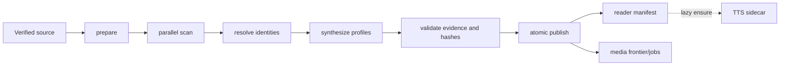

# Разметка книг и TTS

## Ответственность и границы

Серверный enrichment превращает загруженный source в неизменяемый
нормализованный текст, доказательную разметку книги и производные артефакты.
Контур не рендерит книгу и не владеет локальной библиотекой. Его границы:

- вход: content-addressed catalog/private source и метаданные edition;
- контроль: PostgreSQL runs/jobs/leases/publications;
- большие immutable данные: MinIO/S3;
- внешние вычисления: internal generation service или изолированный adapter;
- выход: manifest/progress/preview, `book-markup-v3`, media projection и
  `book-tts-script-v1` sidecar.

## Версии текущего контракта

Значения определены в
[`book-analysis-contracts.mjs`](../../../services/narra-gateway/book-analysis-contracts.mjs):

| Артефакт | Версия |
| --- | --- |
| Analysis pipeline | `book-analysis-v52` |
| Public markup | `book-markup-v3`, schema `3` |
| Scan prompt/extractor | `book-scan-v17` |
| Character synthesis | `character-profile-v15` |
| Identity reconciliation | `character-identity-v22` |
| Character media bundle | `character-bundle-v3` |
| Secondary TTS markup | `book-tts-script-v1`, schema `1` |

## Когда analysis запускается

| Source | Событие | Что ставится автоматически | Что остаётся явным |
| --- | --- | --- | --- |
| Catalog | успешный operator `complete` после проверки source | identity и `ensureAnalysisRun`; после publish — предусмотренная media projection | сам begin/upload/complete, retry/restart, смена pipeline, backfill |
| Private | новый local import после локального commit и успешный upload | resolve/create edition, identity, `ensureAnalysisRun`, polling/resume | пользователь выбирает импорт; explicit retry доступен отдельно |
| Catalog download в Expo | локальная установка готовой catalog book | только download/binding/progress | новый analysis не создаётся |
| Уже готовая publication | чтение manifest | idempotent ensure TTS sidecar job | TTS worker/profile должен быть запущен; повторный analysis не создаётся |
| Server RAG | никакое из перечисленных | ничего | отдельная operator-команда; см. [AI и RAG](./ai-and-retrieval.md) |
| Inline scenes | progress/manifest/publish | ничего | tap пользователя либо operator backfill |

Private object key включает subject и SHA-256:
`books/private/{subjectId}/{contentSha256}/source`; catalog source — общий
content-addressed object. Upload и analysis — разные стадии: сохранённый source
может быть готов, пока manifest ещё `processing`.

Public create-private-edition contract принимает `epub`, `fb2`, `txt`, `pdf`;
mobile также распаковывает `fbz` до FB2 и передаёт конвертированный UMD как
EPUB. Локально читаемые MOBI/AZW/CBZ не считаются автоматически поддержанными
server analysis formats.

## Canonical pipeline



Все стадии durable: worker делает SQL claim с lease, результат идемпотентно
привязан к run/version, а потерянный lease не разрешает stale worker-у
опубликовать результат.

### 1. Prepare

Worker повторно проверяет object bytes, извлекает и нормализует полный текст и
navigation sections, сохраняет immutable normalized object и строит
детерминированные chunks. По умолчанию core стремится к 4 000 UTF-16 символов
в диапазоне 2 500–5 000, context overlap — 500. Непересекающиеся core ranges
покрывают текст ровно один раз; отдельно сохраняются UTF-8 byte ranges и
hash каждого context chunk.

В той же транзакции Prepare пишет два детерминированных артефакта конвейера
карточек персонажей (`book_name_inventory`, `book_card_windows`): инвентарь имён
по всему тексту и окна карточек по главам. Оба считаются без LLM-вызовов — здесь
уже есть полный нормализованный текст, и считать частотность позже значило бы
второй раз читать книгу из хранилища. Сбой инвентаря не роняет Prepare:
сканирующий пайплайн его не читает. См. `docs/work-orders/character-cards-pipeline.md`
и журнал реализации рядом с ним.

### 2. Scan

Независимые jobs получают только ограниченный context chunk. Модель возвращает
наблюдения типов character mention/alias/action/dialogue/trait/appearance/
role/age/gender, event, location и relationship. Каждое принятое наблюдение
содержит exact quote, offsets и chapter key. Gateway проверяет, что цитата
действительно совпадает с immutable source и начинается в core chunk, поэтому
overlap не дублирует evidence.

### 3. Resolve

Детерминированный graph/reconciliation объединяет формы имени и кандидатов,
фиксирует alias ownership и состояния `candidate`, `confirmed`, `rejected`.
Первое подтверждённое появление становится anti-spoiler boundary; смешивать его
с максимальным прогрессом или media warmup запрещено.

### 4. Synthesize

Для подтверждённых персонажей строится evidence-bound profile: имя, роль,
черты, манера/примеры речи, внешность, пол/возраст и progressive personality.
Поля проходят поэлементную валидацию против observations. Synthesis использует
всю книгу, поэтому unlock персонажа скрывает сам профиль до первого появления,
но не гарантирует, что отдельное поле профиля не содержит позднего знания.

### 5. Validate

Проверяются schema/version, coverage, hashes, source/publication lineage,
границы offsets, exact evidence и referential integrity entities/profiles.
Ошибка оставляет последнюю успешную публикацию неизменной.

### 6. Publish

Только validation-ready run атомарно создаёт immutable shadow publication и
делает её canonical reader projection. Manifest раскрывает персонажей согласно
reader text offset и first appearance. Provisional preview служит только UI
хода анализа: он не сохраняется как пользовательская разметка, не питает чат,
портреты, TTS или сцены.

## Две стратегии scan

Новый run фиксирует `pipeline=narra|external`; retry/recovery используют
сохранённую стратегию, а не перечитывают текущий environment default.

### `narra`

Chunk-level `book-scan-v17` вызывает internal LLM generation, собирает все
типы observations и затем использует обычные resolve/synthesize/validate/
publish stages.

### `external`

[`autiobook-adapter`](../../../services/autiobook-adapter/README.md) — отдельный
read-only контейнер над `khimaros/autiobook`, pinned на commit
`d532bdd0a15f2948fd0c99f5e11b92677cb5c3eb`; implementation id —
`external-autiobook-v1.d532bdd0`. Он получает полный normalized text по
внутреннему `POST /internal/v1/analyze`, но наружу выпускает только exact
`character_dialogue` и `character_alias` с UTF-16 offsets. Gateway повторно
валидирует каждую цитату. Далее обе стратегии сходятся в той же schema v3;
external результат закономерно беднее по событиям и профилям и не должен
маскироваться под эквивалентный Narra scan.

## Конвейер карточек персонажей (в работе)

Отдельный путь, заменяющий LLM-обход всей книги как способ *найти* персонажей.
Реализованы детерминированные стадии и контракт; LLM-стадии — нет.

| Артефакт | Модуль | Стадия |
|---|---|---|
| инвентарь имён | `analysis/book-name-inventory.mjs` | Prepare, 0 LLM-вызовов |
| фрагменты-evidence | `analysis/book-character-fragments.mjs` | по подтверждённому roster |
| окна карточек | `analysis/book-card-windows.mjs` | Prepare |
| подтверждение roster | `analysis/book-roster-confirmation.mjs` | 1 LLM-вызов на книгу (не подключён) |
| карточка | `analysis/book-character-card-contract.mjs` | контракт `character-card-v1` |

Два инварианта отличают карточку от текущего профиля персонажа:

- **Окно карточки — структурный спойлер-барьер.** Карточка строится из
  фрагментов от начала книги до конца главы, следующей за главой первого
  упоминания. Факт из главы 8 не может попасть в карточку персонажа из главы 1,
  потому что текст главы 8 в вызов не передаётся.
- **Карточка неизменяема.** Строка не обновляется; новая версия — следующая
  `card_revision`, точечные правки — через correction overlay ниже.

`book-markup-v3` не меняется: после обработки последнего окна v3-проекция
детерминированно собирается из карточек, поэтому TTS sidecar, чат и граф
работают на прежнем контракте.

## Character correction overlay

После publication оператор может применить versioned overlay для точечного
исправления существующих персонажей: role/description, aliases, redirect или
скрытие смешанного профиля. Overlay не меняет immutable publication, не
создаёт новый character key/evidence и откатывается отключением. Полный
контракт: [book-character-correction-overlay.md](../../book-character-correction-overlay.md).

## Secondary TTS markup

### Зачем нужен sidecar

Canonical profile знает персонажей, но не размечает непрерывно каждую реплику.
`book-tts-script-v1` вторично проецирует опубликованный normalized text в
секции и непрерывные сегменты `{narration|speech}`; speech может получить
`character_key` и confidence. Это позволяет выбрать голос персонажа, не меняя
исходный текст и не смешивая TTS-решения с основной entity-разметкой.

### Trigger и построение

`GET /v2/books/:bookEditionId/manifest` вызывает idempotent
`ensureBookTtsMarkup` для актуальной publication. Если TTS worker не включён,
manifest остаётся доступным, а sidecar сообщает `unavailable/processing`.

Worker:

1. читает normalized object и проверяет byte/hash/text length;
2. строит непрерывные sections из navigation;
3. детерминированно выделяет dash/quoted speech, а остальное помечает narration;
4. режет atoms не длиннее 5 000 символов;
5. отправляет speech batches суммарно до 5 000 символов плюс до 500 символов
   соседнего context и roster `{characterKey,name,fullName,aliases}`;
6. принимает только assignment известного atom к известному character или
   `null`, с confidence 0..1;
7. собирает и повторно валидирует непрерывный exact-text script, привязанный к
   source publication, markup content hash и normalized text hash.

### Public API

```http
GET /v2/books/{bookEditionId}/tts-script/sections/{sectionIndex}
Authorization: Bearer <installation_token>
```

Ready response (`200`):

```json
{
  "contract_version": "book-tts-script-v1",
  "revision": 2,
  "normalized_text_hash": "<sha256>",
  "section": {
    "key": "chapter-1",
    "title": "Глава 1",
    "index": 0,
    "start_offset": 0,
    "end_offset": 8421,
    "segments": [
      {
        "id": "tts:0:3",
        "start_offset": 120,
        "end_offset": 176,
        "text": "— Точная реплика из книги.",
        "kind": "speech",
        "character_key": "char:...",
        "confidence": 0.91
      }
    ]
  }
}
```

Пока sidecar строится, API отвечает `202`, `Retry-After` и объектом
`tts_markup`. Публичного POST для создания script нет: trigger — manifest.

### Текущий mobile runtime

Expo на дату ревью не вызывает `/tts-script`. `useReaderTTS` получает sentence
segments/CFI из Foliate, а локальная `voice-markup` эвристика определяет речь и
ищет говорящего по remark/соседним сегментам. Затем `/v2/speech/synthesize`
создаёт audio по явному нажатию «Слушать», а Track Player проигрывает chunks.
Voice override/profile применяются при успешном локальном сопоставлении, иначе
используется narrator. Поэтому серверный sidecar описывает целевой надёжный
speaker contract, но пока не является источником текущего multi-voice playback.

## Инварианты и отказоустойчивость

- Core ranges покрывают normalized text без дыр и двойного владения.
- Quote + offsets должны воспроизводить source exactly; LLM не является
  источником истины для координат.
- Publication атомарна; частичный run не виден как ready.
- TTS script не может пережить смену source publication/hash как валидный.
- Narration и speech вместе покрывают section непрерывно и без изменения текста.
- Отсутствие TTS/media/RAG не снижает availability готовой книги.
