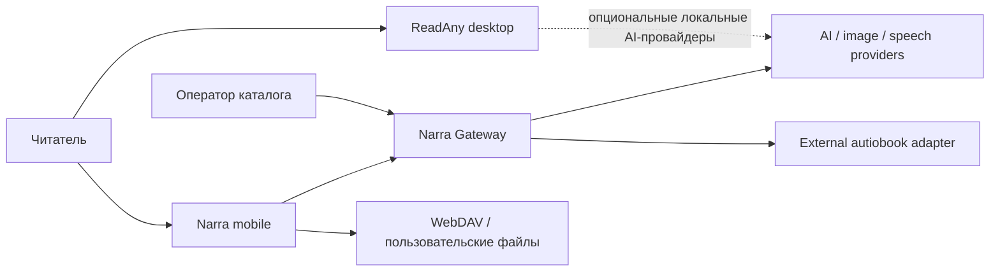
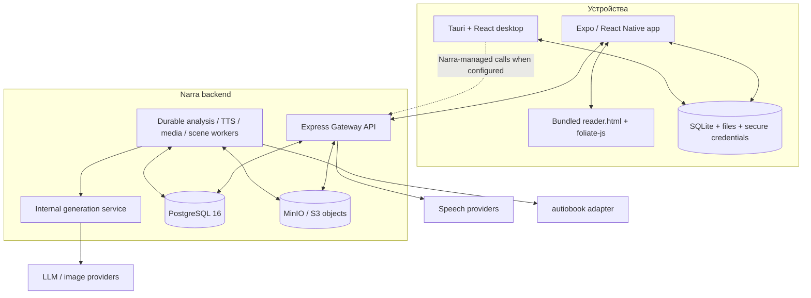

# Текущее состояние архитектуры

## 1. Продукт и происхождение

Narra — форк ReadAny: базовая local-first читалка, библиотека, импорт,
аннотации, синхронизация, локальный AI/RAG и desktop-клиент сохранены в
monorepo. Поверх них Narra добавляет мобильный продукт, серверную идентичность
книг, доказательную разметку персонажей, персональные чаты, управляемые
провайдеры AI/TTS и долговечную генерацию медиа.

Архитектурная граница проходит не между «ReadAny» и «React Native». React
Native — оболочка мобильного клиента; общий домен ReadAny находится ниже неё,
а собственно чтение выполняет ещё один слой — Foliate в WebView. Упрощённая
цепочка выглядит так:

```text
Narra product flows
  -> ReadAny shared domain (@readany/core)
    -> Expo / React Native application shell
      -> WebView bridge
        -> bundled foliate-js parsers and renderer
```

Desktop-клиент — соседняя оболочка над тем же core: React/Vite внутри Tauri,
с прямым использованием `foliate-js`.

## 2. System context



Читатель владеет локальной библиотекой и инициирует чтение, чат, TTS и
пользовательские сцены. Оператор владеет ingest каталога, re-run анализа,
явной индексацией и backfill. Gateway скрывает ключи провайдеров, связывает
установку с приватными книгами и публикует общие артефакты каталога.

## 3. Containers



### Контейнеры в репозитории

| Каталог | Роль | Runtime |
| --- | --- | --- |
| [`packages/app`](../../packages/app) | Desktop UI ReadAny | React 19, Vite, Tauri 2 |
| [`packages/app-expo`](../../packages/app-expo) | Основной мобильный продукт Narra | Expo SDK 57, React Native 0.86 |
| [`packages/core`](../../packages/core) | Общий домен, импорт, DB, AI/RAG, reader/TTS abstractions, sync | TypeScript |
| [`packages/foliate-js`](../../packages/foliate-js) | Встроенный форк browser-движка электронных книг | JavaScript/Web Components |
| [`services/narra-gateway`](../../services/narra-gateway) | Public API, durable orchestration и operator API | Node 24, Express |
| [`services/autiobook-adapter`](../../services/autiobook-adapter) | Изолированная альтернативная разметка диалогов | Python 3.12, FastAPI/Uvicorn |
| [`stats/narra`](../../stats/narra) | Отдельный контур продуктовой статистики | Python/systemd по runbook |

Дополнительные workspace-пакеты содержат CLI, Storybook, сайт и дизайн-примитивы;
они не находятся на основном runtime-пути чтения и серверной разметки.

## 4. Ключевые потоки

### 4.1 Импорт собственной книги

1. Expo импортирует или конвертирует файл, извлекает метаданные/обложку и
   атомарно фиксирует локальную книгу.
2. Для нового поддерживаемого файла без блокировки автоматически и независимо
   запускаются:
   - связывание по SHA-256 и временная загрузка исходника в backend;
   - генерация обложки, только если встроенной/каталожной обложки нет;
   - локальная векторизация, только если пользователь оставил включёнными
     vector model, capability и `autoVectorizeOnImport`.
3. Backend связывает файл с приватным edition, ставит identity и canonical
   analysis. Ошибка фонового контура не откатывает успешный локальный импорт.
4. Клиент после перезапуска возобновляет upload/polling. Приватный source
   изолирован по installation subject и имеет ограниченный срок хранения
   (по умолчанию семь дней).

### 4.2 Книга каталога

1. Оператор выполняет begin/upload/complete ingest; gateway проверяет размер,
   тип и SHA-256 и хранит source по content-addressed key.
2. Завершение ingest автоматически обеспечивает identity и canonical analysis.
3. Обложка может быть загружена оператором независимо от файла книги. После
   публикации разметки сервер может поставить catalog media bundles в очередь,
   если media generation включена.
4. Мобильный клиент скачивает уже подготовленные source/cover/manifest и
   связывает локальную книгу с известным `book_edition_id`; он не загружает
   каталожный source повторно и не запускает private-cover job.

### 4.3 Чтение и прогресс

Expo поднимает локальный static/range server для файла и открывает
сгенерированный `reader.html` в WebView. Foliate разбирает формат и рендерит
секции; bridge передаёт команды, CFI, видимый текст, selection, TTS-сегменты,
имена персонажей и slots сцен. Прогресс сохраняется локально и отправляется в
gateway для серверной anti-spoiler проекции персонажей и медиа.

### 4.4 Обогащение книги

Canonical analysis проходит `prepare -> scan -> resolve -> synthesize ->
validate -> publish`. Публикуется только полностью проверенный immutable
`book-markup-v3`; незавершённый preview не используется чатами или media.
Серверная TTS-разметка — отдельный ленивый sidecar к публикации: чтение
manifest обеспечивает job, но отсутствие sidecar не делает книгу недоступной.
Подробности: [разметка и TTS](./components/book-enrichment.md).

### 4.5 AI и медиа

Чат персонажа получает доказательный профиль, точный видимый отрывок и краткую
память этого персонажа; он не использует book RAG. Чат Нары работает через
reading agent и инструменты, которые получают live reader context и могут
выбрать серверный или локальный book search. Обложки, портреты и сцены имеют
разные trigger и контракты; единый `/v2/media/images` — лишь legacy/synchronous
низкоуровневый маршрут, а не общий durable workflow.

## 5. Данные и владение

| Данные | Каноническое место | Свойства |
| --- | --- | --- |
| Локальная библиотека, позиции, аннотации, chat UI state, скачанные media | SQLite/файлы устройства | local-first; удаление и sync контролирует пользователь |
| Installation credentials | защищённое хранилище устройства | публичные `/v2` требуют installation bearer token |
| Editions, jobs, runs, публикации, progress, media metadata | PostgreSQL | durable lease/retry/idempotency |
| Исходники, normalized text, immutable markup/media assets | MinIO/S3 | content hashes и signed downloads |
| Catalog books/media | backend shared scope | доступны установкам через catalog binding |
| Private book source/artifacts | subject-isolated backend scope | не должны пересекать установки; source TTL ограничен |
| Provider credentials | gateway/internal generation service | не отправляются в mobile bundle |

Главный идентификатор серверной книги — UUID `book_edition_id`; локальный
`book.id`, название и имя файла не являются безопасной заменой. Immutable
публикации связываются с content hash, pipeline version и source publication.

## 6. Trust boundaries

- Public mobile API находится под installation auth и rate/daily budgets.
- Catalog ingest и operator API имеют отдельную operator-auth границу.
- Internal generation endpoints и external adapter используют service token и
  не публикуются как клиентский API.
- Gateway повторно проверяет exact quote/offset evidence от LLM и adapter.
- Клиент проверяет размер/hash скачиваемых canonical media перед локальной
  фиксацией; durable cover job подтверждается `ack` только после сохранения.
- Текст книги и выдержки считаются данными, а не инструкциями для модели;
  prompts явно ограничивают домыслы и спойлеры.

## 7. Deployment

Фактический source-level deployment определён в
[`services/narra-gateway/DEPLOYMENT.md`](../../services/narra-gateway/DEPLOYMENT.md):
`deploy-remote.sh`, параметризованный `compose.i167.yml`, отдельные TEST/PROD
окружения, явные миграции и профили worker-ов. TEST может использовать mutable
`test-latest`; PROD должен получать immutable image reference (SHA/digest/semver).

Основной compose содержит gateway, PostgreSQL 16, MinIO, stage workers
canonical analysis, TTS worker и, по профилям, media/scene workers. Book-search
workers и индексирование не являются обязательной частью стандартного
production topology: серверный search включается feature flag и заполняется
явной operator-командой.

Этот документ не утверждает, что конкретный host в момент чтения здоров или
что feature flag включён: это проверяется runbook-командами и observability.

## 8. Архитектурные инварианты

1. Успешный локальный импорт не откатывается из-за background AI/media/RAG.
2. Непроверенная или частичная разметка не заменяет последнюю publication.
3. Evidence содержит точную цитату и координаты в immutable normalized text.
4. Видимость персонажа определяется `firstAppearance`, а warmup лишь разрешает
   предварительную генерацию asset.
5. Catalog/private isolation применяется и в SQL claim, и в object keys.
6. Повтор запроса с тем же identity/request id должен быть идемпотентным.
7. Автоматическая генерация inline-сцен выключена: её запускает читатель или
   явная operator-команда.
8. Любой внешний provider находится за gateway либо выбран пользователем для
   local-first desktop/core пути.

## 9. Известные разрывы текущей реализации

- Expo TTS пока не потребляет серверную `book-tts-script-v1`; multi-voice
  speaker assignment на устройстве остаётся локальной эвристикой Foliate.
- Structured durable `/v2/media/scene/jobs` реализован на сервере, но в Expo
  нет production call site; активен только canonical book-bound `/scenes/at`
  (legacy selected-text экран удалён 2026-09-17 вместе с ключом OpenRouter в
  клиенте — единственный путь к AI теперь gateway).
- В `ChatScreen` semantic context не передаётся прямо в system prompt; актуальный
  reader context доступен агенту через tools и приложенную selection.
- Полный профиль уже открытого персонажа может содержать сведения из более
  позднего текста: скрытие до `firstAppearance` не является полной
  field-level защитой от спойлеров.
- Server RAG не создаётся автоматически и может отсутствовать даже при готовой
  canonical разметке; клиент должен обрабатывать fallback/not-ready.
- Источник описывает желаемую topology, но не доказывает состояние TEST/PROD в
  реальном времени.
